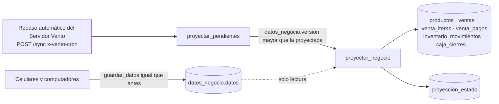

# Arquitectura de datos · Fase A: proyección relacional (Vento 1.52.1)

Sigue a `puente/ARQUITECTURA-DATOS-FASE1.md` (sección 6, «Fase 2/4-A»). Resuelve la primera parte del hallazgo **D1**:
las ventas, el inventario y el catálogo ya se pueden consultar con SQL, con tipos, claves y RLS por rol. **Las apps no
cambian:** el documento `datos_negocio.datos` sigue siendo la fuente de verdad.

Archivos:
- `supabase/migrations/20261031000000_proyeccion.sql`: tablas, funciones y RLS;
- `supabase/functions/vento-pagos/app.ts`: el repaso `/sync` llama `proyectar_pendientes`;
- `pruebas/servidor/proyeccion.test.js`: 66 comprobaciones.

## Cómo se llena



- **No hay trigger en `datos_negocio`:** el guardado de la app es exactamente el mismo y la proyección nunca lo bloquea,
  porque solo lee el documento.
- **Pendiente** = `datos_negocio.version` mayor que `proyeccion_estado.version_proyectada`.
- **Cuándo corre:** en cada repaso automático. El flujo pide «cada 10 minutos», pero GitHub corre esos repasos con
  retraso: en la práctica, cada 1 a 3 horas. Para reportes del día alcanza; si hace falta más seguido, se puede programar
  dentro de Supabase (`pg_cron`).
- **Idempotente:**
  - cada fila usa el ID que ya trae en el JSON y una huella (`md5`) del objeto;
  - solo se reescribe lo que cambió, y proyectar dos veces el mismo documento no toca nada (probado).
- **Por tandas:**
  - como máximo 1500 ventas nuevas o cambiadas por llamada, de la más reciente a la más vieja;
  - un negocio con miles de ventas se completa en varias tandas dentro del tope de tiempo (4 s por repaso), sin pasarse
    del límite de la petición.
- **Errores:**
  - un negocio con error queda con `proyeccion_estado.error` y los demás siguen;
  - se reintenta a los 5, 10, 20… minutos, hasta cada 6 horas.
- **Seguro de espacio:** si la base pesa más de 400 MB no proyecta. El plan gratis de Supabase da 500 MB y, si se llena,
  deja la base solo de lectura: primero está que la app pueda guardar.

## Tablas nuevas

| Tabla | Clave | De dónde sale (JSON) | Qué guarda |
|---|---|---|---|
| `producto_categorias` | `(negocio_id, id)` | `categories[]` | nombre |
| `productos` | `(negocio_id, id)` | `products[]` | nombre, tamaño, categoría (FK), precio, stock, mínimo, combo, códigos de barras (`text[]` con índice GIN) y el resto en `extra` **sin costos** |
| `producto_costos` | `(negocio_id, producto_id)` FK | `products[].cost` | costo actual |
| `ventas` | `(negocio_id, id)` | `history[]` | fecha UTC, lugar (`mesa` / `mostrador` / `domicilio`), mesa, factura, persona, total, deuda, quién cobró; DIAN, domicilio y lo demás en `extra` **sin costos** |
| `venta_items` | `(negocio_id, venta_id, linea)` FK | `history[].items[]` | producto, cantidad, **precio histórico**, subtotal calculado, unidad (kg/lb), persona |
| `venta_costos` | `(negocio_id, venta_id, linea)` FK | `history[].items[].cost` | **costo histórico** de cada línea |
| `venta_pagos` | `(negocio_id, venta_id, linea)` FK | `history[].payments[]` | método (efectivo, nequi, transferencia, debe…), monto, nota y comprobante |
| `inventario_movimientos` | `(negocio_id, id)` | `inventarioMov[]` | producto (FK si existe), tipo, cantidad, unidad, usuario, fecha |
| `caja_cierres` | `(negocio_id, id)` | `closures[]` | fecha, desde, tickets, totales por método; caja y horas en `extra` |
| `proyeccion_estado` | `negocio_id` | — | versión proyectada, cuándo, cuánto tardó, conteos y error |

Integridad:
- plata en `numeric(16,2)` y cantidades en `numeric(16,3)` (venta por peso);
- fechas `timestamptz` en UTC;
- claves foráneas compuestas con `negocio_id`, para que nada se cruce entre negocios;
- CHECK en IDs, lugar, método y línea.

Lo que el documento trae mal no rompe la proyección:
- un número ilegible queda vacío o en 0;
- una fecha mala toma la del ID (`Date.now()` de la app);
- una categoría o un producto que ya no existe queda sin enlace, con el nombre guardado;
- lo que no es objeto se ignora.

## Nada se borra
- **Venta que sale del documento** (deshecha o borrada) → `eliminada_en`. Si vuelve, porque otro equipo la tenía, se
  reactiva.
- **Producto, categoría o cierre que sale del documento** → `eliminado_en`.
- **Movimientos de inventario:** solo se agregan. La app guarda los últimos 4000 en el documento; aquí quedan todos.
- **Venta corregida** (devolución o cambio): sus ítems, costos y pagos se reescriben iguales al documento. Las versiones
  anteriores siguen en los 48 respaldos por hora de `respaldos`.

## Quién ve qué (RLS; nadie escribe directo)

| | Dueño | Administrador | Cajero | Mesero / empleado | Otro negocio / sin sesión |
|---|---|---|---|---|---|
| Categorías y productos (sin costos) | ✅ | ✅ | ✅ | ✅ | ❌ |
| Ventas, ítems y pagos | ✅ | ✅ | ✅ | ❌ | ❌ |
| Inventario y cierres de caja | ✅ | ✅ | ✅ | ❌ | ❌ |
| Costos (producto y de cada venta) | ✅ | ✅ | ❌ | ❌ | ❌ |
| Estado de la proyección | ✅ | ✅ | ❌ | ❌ | ❌ |

- `anon` y `authenticated` no tienen `insert`, `update` ni `delete` en estas tablas.
- `proyectar_negocio` y `proyectar_pendientes` solo las puede llamar `service_role`.
- La migración pasa `revisar-migraciones.js`: no borra datos y todas las tablas tienen RLS.

## Ejemplos de consultas (como dueño, por la API o en el SQL Editor)

```sql
-- Ventas por día y método de pago del último mes
select date_trunc('day', v.fecha at time zone 'America/Bogota') dia, p.metodo, sum(p.monto)
from ventas v join venta_pagos p using (negocio_id) where p.venta_id = v.id
  and v.negocio_id = :negocio and v.eliminada_en is null and v.fecha > now() - interval '30 days'
group by 1, 2 order by 1, 2;

-- Margen por producto con el costo HISTÓRICO de cada venta
select i.producto_nombre, sum(i.subtotal) vendido, sum(i.cantidad * c.costo) costo
from venta_items i join ventas v on v.negocio_id = i.negocio_id and v.id = i.venta_id
left join venta_costos c using (negocio_id, venta_id, linea)
where i.negocio_id = :negocio and v.eliminada_en is null group by 1 order by 2 desc;
```

## Cómo apagarlo o devolverlo
- **Apagarlo:** quitar la llamada a `proyectar_pendientes` en `vento-pagos/app.ts`. Las tablas quedan como estaban y la
  app no lo nota.
- **Rehacer un negocio:** `update proyeccion_estado set version_proyectada = 0 where negocio_id = …`. El próximo repaso
  lo vuelve a proyectar sin duplicar.
- **Vigilar:** `select negocio_id, version_proyectada, proyectado_en, duracion_ms, filas, error from proyeccion_estado`.
  La respuesta del repaso `/sync` trae `proyeccion: {proyectados, fallidos, pendientes, base_mb}`.

## Lo que sigue
- **Fase 3 · Seguridad:**
  - políticas por rol en `pagos` y `datos_negocio` (D5);
  - `guardar_datos` revisa por rol qué partes cambia un mesero (D2);
  - `iaClave` pasa a `integraciones` (D6);
  - el canal del cliente del QR solo escribe (D8).
- **Leer desde estas tablas:**
  - el tablero de estadísticas del servidor;
  - Laya con cifras de SQL;
  - mesas abiertas (`tables`), compras y turnos de caja, en una segunda tanda de la proyección.
- **Fase 4-B:** escritura por RPC con clave de idempotencia (`registrar_venta`, `mover_inventario`).
