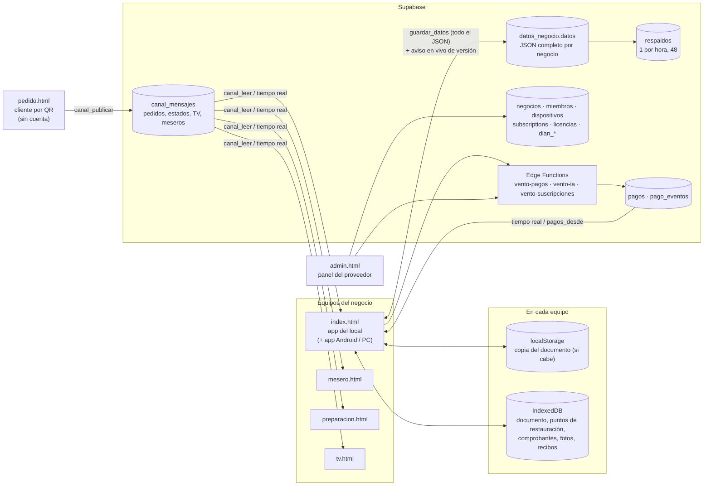
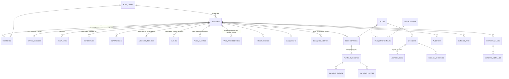

# Vento · Arquitectura de datos · FASE 1: auditoría y diagnóstico

Fecha: 2026-10-23. Base: versión 1.52.0 (rama `ccr-41bb424c-ri1zdh`).

**Método:** las 24 migraciones se cargaron en un PostgreSQL 16 real con lo mínimo de Supabase
(`pruebas/servidor/supabase-local.js`), y se consultaron el catálogo (`information_schema`, `pg_policies` y
`pg_constraint`) y el código de todas las apps. Lo que dice «verificado» se comprobó así. Lo demás sale de leer el
código.

**En esta fase no se cambió ninguna tabla ni ninguna app.**

---

## 1. Resumen ejecutivo

Vento tiene **dos mundos de datos** muy distintos.

| | **A. Capa de plataforma (relacional)** | **B. Datos operativos de cada negocio (documento)** |
|---|---|---|
| **Qué guarda** | Negocios, miembros y roles, dispositivos, pagos electrónicos, eventos de pago, suscripciones, planes, licencias, DIAN, canales en vivo, archivos, soporte, errores, auditoría de plataforma | Catálogo, categorías, mesas y cuentas abiertas, **historial de ventas**, cierres de caja, turno y arqueo, inventario y kárdex, compras y facturas de proveedor, clientes frecuentes, configuración, Laya |
| **Dónde** | 38 tablas en Supabase (PostgreSQL) | **Un solo JSON por negocio**: `datos_negocio.datos` (jsonb). En cada equipo, una copia completa en IndexedDB y `localStorage` |
| **Integridad** | 64 claves foráneas, CHECK, UNIQUE e índices | Ninguna en el servidor: la valida la app |
| **Seguridad** | RLS en las 38 tablas (verificado), políticas con `es_miembro()` / `rol_en()` | RLS por negocio sí; **por rol no**: cualquier miembro lee y reescribe todo el documento |
| **Concurrencia** | Transacciones SQL, idempotencia por huella (Wompi, avisos) | Versión entera por documento y mezcla de 3 vías en el cliente (`fusionar()` en `nube/vento-nube.js`) |
| **Reportes** | SQL posible | Solo en el equipo, recorriendo el JSON |

**Conclusión:** la parte de plataforma ya tiene estándares de SaaS serio. La parte del negocio (ventas, inventario,
pedidos) **no es relacional**: es el núcleo que hay que llevar, poco a poco, a tablas con `negocio_id`, RLS por rol,
idempotencia e historial. Hacerlo de golpe rompería todas las apps, que leen y escriben ese JSON. Por eso el plan de
la sección 6 es incremental y reversible.

---

## 2. Arquitectura actual (aplicaciones y almacenamiento)

**Notas:**
- **Mesero, preparación, TV y cliente del QR** no leen `datos_negocio`: hablan con la app del local por **canales**.
  Cada uno es una tabla con mensajes persistentes, número único, 8 días de vida y aviso en vivo. ntfy ya no se usa.
- **La app del local es la que «sabe»:** suma los pedidos a las cuentas (sin duplicar, por el ID del pedido),
  descuenta el inventario y guarda el historial, todo dentro del JSON.

---

## 3. Modelo relacional actual (lo que sí está en tablas)

**Tablas sueltas, sin `negocio_id` a propósito:**
- canales: `canal_mensajes`;
- configuración: `servidor_config`, `billing_config`, `frases_pago`;
- administración: `admin_correos`, `admin_push`, `platform_admins`;
- seguimiento: `instalaciones`, `app_errores`;
- DaviPlata: `daviplata_consecutivos`.

**Cifras (verificado):**
- 38 tablas, 64 claves foráneas, 167 funciones, 10 triggers;
- **RLS activado en las 38**;
- anónimo: no lee ni escribe ninguna tabla directo. Solo llama funciones (canales, soporte, catálogo de planes,
  `pagos_dispositivo` con token, reporte de errores).

**Plata:**
- `pagos.monto`, `payment_records.amount` y `plans.price` son **bigint en pesos enteros**;
- `dian_documentos.total` es **numeric**.

Para el peso colombiano, que en la práctica no usa centavos, el bigint de pesos enteros es **exacto**: no es float. El
IVA (que puede dar fracciones) se calcula en `dian_documentos` con numeric. **Recomendación:** no cambiar lo que
funciona; en las tablas nuevas, usar `numeric(14,2)` para precios e impuestos y `bigint` para totales cobrados.

---

## 4. Qué hay dentro del documento JSON (`datos_negocio.datos`)

Las claves más usadas por el código (veces que aparecen) y la tabla a la que deberían ir con el modelo propuesto:

| Clave del JSON | Usos | Qué es | Destino propuesto |
|---|---|---|---|
| `tables` | 259 | Mesas y cuentas abiertas (ítems, personas, abonos) | `mesas`, `mesa_sesiones`, `ordenes`, `orden_items` |
| `products` | 176 | Catálogo: precio, costo, stock, códigos, combos, unidades | `productos`, `producto_codigos`, `producto_precios`, `inventario` |
| `history` | 58 | **Ventas cerradas** con ítems, pagos, fiado y documento DIAN | `ventas`, `venta_items`, `venta_pagos` |
| `categories` | 29 | Categorías | `producto_categorias` |
| `closures` | 22 | Cierres del día | `caja_cierres` |
| `purchases` | 19 | Facturas de proveedor leídas con IA | `compras`, `compra_items`, `proveedores` |
| `inventarioMov`, `stockLog` | 22 | Movimientos de inventario y kárdex | `inventario_movimientos` |
| `turno` | — | Caja: base, entradas, salidas y arqueo | `caja_turnos`, `caja_movimientos` |
| `pagos` | 31 | Copia local de los avisos de pago (lista, esperas) | ya está en `pagos`: dejar solo la caché |
| `clientesFrecuentes`, `casos` | 20 | Clientes y reclamos | `clientes`, `cliente_casos` |
| `auditoria`, `layaLog` | 19 | Quién hizo qué (en el equipo) | `auditoria` (ya existe la tabla) |
| `equivalencias`, `renombres`, `unificaciones` | 29 | Unidades combinadas y nombres viejos | `producto_unidades`, `producto_alias` |
| `iaClave` | 6 | **Clave de IA propia del negocio** | ⚠️ secreto: no debe estar en el documento (ver D6) |

---

## 5. Diagnóstico (hallazgos, de mayor a menor gravedad)

| # | Gravedad | Hallazgo | Evidencia | Propuesta |
|---|---|---|---|---|
| D1 | 🔴 Crítica | **El núcleo del negocio no es relacional.** Ventas, inventario, mesas y compras viven en un JSON: sin claves foráneas, sin CHECK, sin historial por fila, sin SQL para reportes. Cada cambio sube el documento completo | `guardar_datos(p_negocio, p_datos, p_version)` reemplaza `datos` entero | Fase 2/4: proyección relacional primero (sin tocar las apps) y escritura por dominio después |
| D2 | 🔴 Crítica | **Los roles no se aplican en el servidor para los datos del negocio.** `guardar_datos` solo pide `es_miembro()`: un mesero (o un equipo con un fallo) puede reescribir precios, historial y caja | Función `guardar_datos` | Validación por rol en el servidor (qué partes puede cambiar cada rol) y, después, escritura por RPC |
| D3 | 🟠 Alta | **Las operaciones del negocio no tienen idempotencia en el servidor.** Los pedidos por QR sí la tienen (ID en el canal y la app los suma una vez); ventas e inventario dependen de la mezcla en el cliente | `fusionar()`, `unirListas()` en `nube/vento-nube.js` | RPC `registrar_venta` y `mover_inventario` con clave de idempotencia (principio de Stripe) |
| D4 | 🟠 Alta | **Un aviso de pago queda «aprobado».** Los avisos leídos en el celular quedan `estado='aprobado'` con `confianza='app'`: un aviso no es una confirmación del banco | Tabla `pagos`, `avisos.ts` | Estado aparte («confirmado por aviso») y conciliación con la fuente oficial cuando exista (Wompi, Nequi API) |
| D5 | 🟠 Alta | **Un mesero puede leer desde el servidor todos los pagos y el documento completo** (incluye pagadores). La app lo esconde, la base no | Políticas `pagos_ver` y `datos_ver` = `es_miembro()` | Políticas por rol: pagos solo para dueño y administrador |
| D6 | 🟠 Alta | **Secreto en el documento compartido:** la clave de IA propia del negocio (`data.iaClave`) se copia a todos los equipos, a la nube y a los respaldos | `index.html:11092` | Moverla a `integraciones.secreto` (cifrado en el servidor, como Wompi) |
| D7 | 🟡 Media | **No hay organizaciones ni sucursales en el servidor.** Las «sedes» existen solo en cada celular (otra clave local) | `bar-current-sede`, `STORAGE_KEY` por sede | Tablas `organizaciones` y `sucursales` con FK opcional desde `negocios` (no rompe nada) |
| D8 | 🟡 Media | **Los clientes del QR leen el canal común de pedidos:** con el QR de una mesa se leen 8 días de pedidos de todo el negocio, y los domicilios traen nombre, teléfono y dirección | `canal_leer` con el nombre del canal | Canal del cliente que solo escribe; lectura solo de lo suyo |
| D9 | 🟡 Media | **Dos idiomas y dos modelos de cobro conviven:** `licencias` y `licencia_usos` en español, `subscriptions`, `payment_records` y `plans` en inglés. No es un duplicado (los códigos de licencia dan días de suscripción), pero confunde | Migraciones de suscripciones y licencias | Documentar la relación y la vista `estado_suscripcion` unificada. No renombrar tablas que ya funcionan |
| D10 | 🟢 Baja | **Respaldo verificable:** hay 48 respaldos por hora del documento en el servidor y puntos diarios en cada equipo, pero no hay prueba automática de restaurar uno del servidor | `respaldos` | Prueba de restauración en `pruebas/` y plan de respaldo de Supabase (PITR) |

**Lo que está bien y se conserva:**
- RLS en todas las tablas y anónimo sin acceso directo;
- idempotencia de Wompi y de los avisos por huella;
- `aplicar_pago` decide qué equipo registra cada pago;
- dispositivos con token cifrado (hash) y revocación;
- licencias validadas en el servidor;
- canales persistentes con número único.

---

## 6. Propuesta de fases (sin pérdida de datos ni cortes)

**Regla:** cada paso es una migración que **no borra nada** (lo revisa `pruebas/servidor/revisar-migraciones.js` antes
de desplegar), con sus pruebas, y las apps siguen funcionando igual durante la transición.

### Fase 2/4-A · Proyección relacional (sin cambiar las apps) — bajo riesgo, alto beneficio
- **Tablas nuevas** con `negocio_id`, UUID, `creado_en` y `actualizado_en` en UTC, CHECK y claves foráneas:
  - `productos`, `producto_categorias`, `producto_codigos`;
  - `ventas`, `venta_items` (precio, costo, IVA y descuento **históricos** de cada venta), `venta_pagos`;
  - `inventario_movimientos`;
  - `compras`, `compra_items`, `proveedores`;
  - `caja_turnos`, `caja_movimientos`.
- **Llenado automático:** un trigger en `datos_negocio` las llena (*upsert* idempotente por el ID que ya trae cada
  venta, producto o movimiento en el JSON) cada vez que un equipo guarda.
- **Las apps no cambian.** Se gana:
  - reportes SQL, como el tablero desde el servidor;
  - historial;
  - datos limpios para Laya;
  - y la base para lo que sigue.
- **RLS por rol desde el principio:** el mesero no ve costos ni pagos.
- **Pruebas:** que la proyección refleje exactamente el JSON (cantidades, totales y precios históricos), que sea
  idempotente (guardar dos veces el mismo documento no duplica filas) y aislamiento entre negocios.

### Fase 3 · Seguridad
- Políticas por rol en `pagos` y `datos_negocio` (D5).
- `guardar_datos` valida por rol qué partes del documento puede cambiar un mesero (D2).
- `iaClave` pasa a `integraciones` (D6).
- Canal del cliente del QR que solo escribe (D8).

### Fase 4-B · Escritura por dominio con idempotencia
- **RPC con `p_clave_idempotencia`:** `registrar_venta`, `deshacer_venta`, `mover_inventario` y `registrar_compra`.
  Repetirla no duplica la venta ni el movimiento.
- **Transición:** la app escribe en la RPC **y** en el documento. Cuando todo cuadre, el documento queda solo como
  caché para trabajar sin internet.
- **Organizaciones y sucursales** (D7) con FK opcional, y estado «confirmado por aviso» en pagos (D4).

### Fase 6 · Pruebas obligatorias (todas automatizadas en `pruebas/`)
- **Aislamiento:**
  - aislamiento entre negocios;
  - permisos de mesero;
  - usuario con varios negocios.
- **Pedidos:**
  - el pedido QR llega al negocio correcto;
  - el pedido reenviado no se duplica.
- **Plata e inventario:**
  - el pago repetido no se duplica;
  - el inventario no se descuenta dos veces;
  - la venta conserva sus precios históricos.
- **Operación:**
  - una licencia vencida se valida bien;
  - dos equipos a la vez no producen inconsistencias;
  - un respaldo del servidor se restaura;
  - las apps actuales siguen pasando sus pruebas.

---

## 7. Decisiones que necesitan la autorización del dueño

Esta fase se detiene aquí para cumplir la regla «si puede haber pérdida de datos, interrupción o incompatibilidad,
detenerse y explicarlo»:

1. **Empezar por la Fase 2/4-A (proyección relacional).**
   - **Riesgo:** bajo. Las apps no cambian. Si algo falla, se apaga el trigger y todo sigue igual.
   - **Costo:** más escritura en la base de datos en cada guardado. Se puede limitar a proyectar solo lo que cambió.
2. **Cambiar la fuente de verdad** (del documento a las tablas, Fase 4-B). Toca todas las apps y se hace dominio por
   dominio, con convivencia y pruebas: **no antes de terminar la Fase 2/4-A y verla funcionando en producción**.
3. **Plan de respaldo:**
   - activar los respaldos de Supabase (PITR, según el plan contratado);
   - mantener los 48 respaldos por hora del documento;
   - agregar la prueba automática de restauración.
